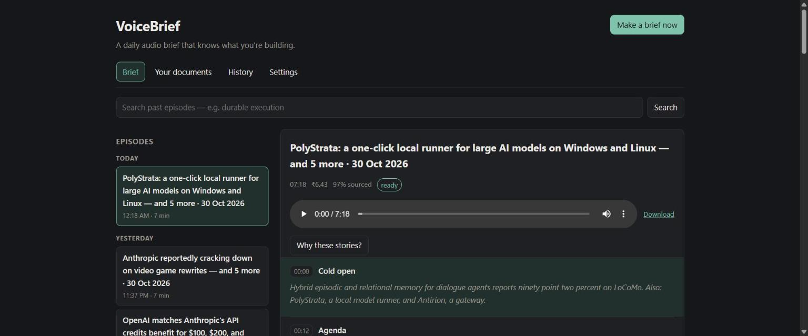

# VoiceBrief

[](https://github.com/ParthBiyani/Voice-Brief/actions/workflows/ci.yml)


[](LICENSE)

**A daily audio brief that knows what you're building.** Every morning it reads 43 tech
sources, drops what you've already heard, picks the stories that matter to *your* stack,
writes a script in which every claim is checked against its source, voices it, and sends
it to Slack, where you can ask it follow-up questions.



> *"Kokoro can now clone a voice … This touches Voice-Brief directly, because you use
> Kokoro there."* (from a real brief, generated from live sources and the author's GitHub)

## Highlights

| | |
|---|---|
| **Personal** | Ranks by your GitHub dependencies, declared topics, your thumbs, and (optionally) [ProjectMind](https://github.com/ParthBiyani/ProjectMind)'s memory of how you work. 5 of 6 stories matched the owner's stack on the latest run |
| **Fresh, never repeated** | Only what's new since your last brief; anything already aired is skipped, even if re-clustered |
| **Grounded** | Every sentence's figures, versions and names are checked against the source; 0 invented links across every recorded run |
| **Hands-off** | Windows Task Scheduler runs it at 09:00 and catches up after sleep; the web app stays up on its own |
| **Ask anything** | Reply in Slack or tap a line in the web app; answers come only from that brief's sources |
| **Your documents too** | PDFs, notes or a whole repo become an episode, with a segment on where they disagree |
| **Cheap** | About ₹7–8 a brief (≈ $0.08), capped by a daily budget checked before every model call |

## How it works

```
 09:00 ─► ingest ─► filter ─► embed ─► dedup ─► cluster ─► rank ─► re-rank ─► write ─► verify ─► voice ─► deliver
          43 feeds   fresh +   bge-     0.92     stories    stack,   LLM on     one      every     Kokoro   Slack +
          & APIs,    trusted   small    cosine   not topics content  the top    segment  claim     → MP3    web app
          full text                                         topics,  30         a story  checked
                                                            thumbs
```

| Layer | Choice |
|---|---|
| Sources | arXiv, Hacker News, GitHub (trending + your dependencies' releases), Hugging Face, AI lab and engineering blogs, tech news (Techmeme, TechCrunch, The Verge, Ars Technica, WIRED, MIT Tech Review, InfoQ, Inc42 …). Official APIs and published feeds; where a feed gives one line, the linked article's text is fetched (robots.txt honoured) |
| Pipeline | Python 3.14 · LangGraph · sentence-transformers (bge-small) · HDBSCAN |
| Models | Claude Sonnet 5.5 writes the script; Haiku 5.5 does ranking, summaries and Q&A |
| Speech | Kokoro via ONNX Runtime (local, no GPU), encoded to MP3 |
| Storage | Postgres 16 · Qdrant · MinIO (audio) · Redis (reserved for a job queue), all in Docker |
| App | FastAPI + React/Vite, served together on one port |
| Delivery | Slack bot (digest, audio in thread, Q&A over Socket Mode) · optional email |

Deep dive: [PRD.md](PRD.md) for requirements and success metrics; [eval/EXPERIMENTS.md](eval/EXPERIMENTS.md) for what was tried and rejected.

## Results

**Offline, reproducible** (`make eval`; a frozen, hand-labelled corpus of 500 crawled items, no API key):

| Component | Metric | Result | Target |
|---|---|---:|---:|
| Deduplication | pairwise precision / recall | **1.000 / 0.971** | 0.90 / 0.80 ✅ |
| Clustering | homogeneity | **0.814** | 0.75 ✅ |
| Ranking, full path (heuristic + model re-rank) | precision@10 / nDCG@10, independent judge labels | **0.600 / 0.74** | 0.70 ❌ |
| Ranking, heuristic stage | precision@10, judge / rubric labels | 0.533 / 0.500 | |
| Personalization ablation | nDCG@10, judge labels: stack + topics / topics / none | **0.660** / 0.606 / 0.084 | |

**Live** (real sources, real models, one laptop):

| | |
|---|---|
| Claims traced to a source | **0.966** on the latest brief (0.857 before the verifier fixes) |
| Stories matched to the listener | **5 of 6** (0–1 before personal context was wired in) |
| Cost | ₹6.4 recorded at ₹83.5/$, which is **₹7.7 at ₹100/$**; the script is ~95% of it |
| Time | ~45 s without audio, ~3 min with 6–7 min of speech |
| Invented links | **0** |

These are single-user runs, not a benchmark. Ranking misses its target and says so. It is
measured on two label sets, a keyword rubric and an independent model judgement, because
each alone flatters a different kind of ranker. The details and what was tried are in
[eval/EXPERIMENTS.md](eval/EXPERIMENTS.md).

## Quick start (Windows)

You need Python 3.11+ (3.14 tested), Docker Desktop, Node 22 and an Anthropic API key.

```powershell
git clone https://github.com/ParthBiyani/Voice-Brief.git; cd Voice-Brief
py -3.14 -m venv .venv
.\.venv\Scripts\python.exe -m pip install -e ".[ml,llm,docs,tts,dev]"

copy .env.example .env                                          # add ANTHROPIC_API_KEY
docker compose up -d --wait                                     # Postgres, Qdrant, Redis, MinIO
.\.venv\Scripts\python.exe -m alembic upgrade head
.\.venv\Scripts\python.exe -m voicebrief.cli sources sync
.\.venv\Scripts\python.exe -m voicebrief.cli tts setup          # one-off, ~350 MB voice model
cd web; npm ci; npm run build; cd ..

.\.venv\Scripts\python.exe -m voicebrief.cli daily --github YOUR_GITHUB_LOGIN
.\scripts\install-schedule.ps1      # brief at 09:00 + web app always on at http://localhost:8000
```

`daily` remembers your settings, does nothing if today's brief exists (`--force` makes another),
and exits **0** ok, **2** degraded, **1** failed. Logs: `%LOCALAPPDATA%\VoiceBrief\logs`.

Strongly recommended: a fine-grained `GITHUB_TOKEN` (*Contents: read-only*), which raises
GitHub's limit from 60 to 5,000 requests an hour.

## Slack

1. Create a Slack app with bot scopes `chat:write`, `files:write`, `channels:read`,
   `channels:history`; enable **Socket Mode** and subscribe to the `message.channels` bot event.
2. Install it, invite the bot to a channel, and set `SLACK_BOT_TOKEN`, `SLACK_CHANNEL_ID`
   and `SLACK_APP_TOKEN` (the `xapp-` token, scope `connections:write`) in `.env`.
3. `python -m voicebrief.cli deliver test`

Each brief arrives as a digest with the audio in its thread. **Reply in the thread** to ask
about that brief, or post in the channel to ask about the latest one. Socket Mode means no
public URL is needed; the listener runs inside the web app's process. A failed run posts a
short "could not make today's brief" message, so silence never means confusion.

## Usage

| Command | What it does |
|---|---|
| `daily` | The whole morning loop (what the scheduler runs) |
| `serve [--host 0.0.0.0]` | Web app + API on one port; also answers in Slack |
| `docs podcast <files/folders>` | Your own material as an episode |
| `history show [--date]` · `history export` | What happened and why; JSONL for analysis |
| `deliver status / test / episode <id>` | Slack and email |
| `backup create / list / restore` | Database dump + audio copy |
| `personal show [--refresh]` | What ProjectMind told VoiceBrief |
| `ingest run [-s slug]` · `enrich` · `brief generate` | Individual steps |
| `sources sync / list` · `tts setup / test` | Source registry, voice model |

All commands: `python -m voicebrief.cli <command>` (or `voicebrief <command>` where Windows allows the launcher).

## Configuration

| Variable | Default | |
|---|---|---|
| `ANTHROPIC_API_KEY` | | Required |
| `GITHUB_TOKEN` | | Recommended |
| `VB_DAILY_BUDGET_INR` | `50` | Hard stop, checked before every model call |
| `VB_USD_TO_INR` | `100` | Rate for the rupee cost ledger |
| `VB_LLM_SCRIPT_MODEL` / `VB_LLM_UTILITY_MODEL` | `claude-sonnet-5-5` / `claude-haiku-5-5` | |
| `VB_TIMEZONE` | `Asia/Kolkata` | What "today" means |
| `SLACK_BOT_TOKEN`, `SLACK_CHANNEL_ID`, `SLACK_APP_TOKEN` | | Delivery and Q&A |
| `VB_SMTP_*`, `VB_MAIL_FROM`, `VB_EMAIL_TO` | | Optional email delivery |
| `VB_API_TOKEN`, `VB_PUBLIC_URL` | | Needed to serve beyond localhost |
| `VB_PROJECTMIND_CMD` | | Enables ProjectMind |
| `VB_BACKUP_DIR`, `VB_BACKUP_KEEP` | per-user folder, `7` | |
| `VB_HISTORY_RETENTION_DAYS` | `90` | How long prompt text is kept |

`VB_LLM_PROVIDER=echo` and `VB_TTS_ENGINE=null` run everything offline for tests;
`ollama` runs a local model for ₹0. Full list: [.env.example](.env.example).

<details>
<summary><b>More: phone access, history, backups, ProjectMind, adding a source</b></summary>

### On your phone
Set `VB_API_TOKEN` (a long random string) and `VB_PUBLIC_URL=http://<laptop-ip>:8000`, run
`serve --host 0.0.0.0` (or `run-serve.ps1 -Address 0.0.0.0`), open the URL and enter the
token once. `serve` refuses to listen on the network without a token, because anyone who
reached it could spend money. Away from home, use a private network such as Tailscale.

### What "ready" means
An episode is `ready` only with stories, stored audio that actually has sound, and at least
half the stories asked for; otherwise `degraded` (usable, something missing, reason stored)
or `failed`. A crash leaves `interrupted`, closed out on the next run.

### History
Every run, every candidate considered (each ranking signal's contribution, the model's
reason, picked or skipped and why), every model call (prompt, response, tokens, cost) and
every question asked on the web or in Slack is stored. Prompt text is kept 90 days; costs
and metadata forever. The *History* page and `history show` replay any day.

### Backups
After every generated brief, the database is dumped (verified with `pg_restore --list`)
and new audio copied to `%LOCALAPPDATA%\VoiceBrief\backups`, outside Docker's disk image,
keeping the newest seven. This exists because a hard freeze once corrupted that image.
`backup restore` puts the newest dump back.

### ProjectMind
[ProjectMind](https://github.com/ParthBiyani/ProjectMind) is the author's cross-project
memory. When `VB_PROJECTMIND_CMD` is set, VoiceBrief asks it about your technologies, uses
the answers in ranking and lets the writer say "this is the tradeoff you made in another
project". Only its public CLI is used; its raw private notes are never read.

### Adding a source
Add an entry to `config/sources.yaml` and run `sources sync` (idempotent; removed entries are
disabled, not deleted). `cluster: solo` marks a trending-list source whose entries are each
their own story.

</details>

## Development

```powershell
make test         # hermetic unit tests (echo LLM, silent TTS)
make test-all     # + integration tests against the Docker services
make lint; make typecheck; make eval; make ablation
```

**821 tests**; CI runs lint, mypy, the web build and the backend suite against real Postgres
and Qdrant on Python 3.11 and 3.14 for every push.

```
src/voicebrief/
├── sources/          one adapter per upstream
├── pipeline/         ingest, filter, embed, dedup, cluster, rank, summarize, ground, daily, episodes
├── graphs/           the writing graphs (brief, documents)
├── personalization/  GitHub profile, ProjectMind adapter, feedback affinity
├── delivery/         digest, Slack (send + listen), email
├── llm/  tts/  documents/  api/  evalkit/
├── qa.py             answering questions about a segment or a whole episode
└── history.py        the audit trail
```

## Limitations

- **Ranking is below its offline target** (P@10 0.600 vs 0.70 for the full path). The
  labels are synthetic (3 personas); real thumbs are the route to a trustworthy number.
- **Verification is lexical, not entailment:** it catches invented figures, versions and
  names, not a sentence that reuses the source's words with the meaning flipped.
- **Some articles can't be fetched:** full text comes from the linked page (robots.txt
  honoured), so paywalls and sites that refuse bots stay at their one-line summary.
- **Thumbs are a gentle nudge** (at most 1.5 points vs 3 for a dependency match), not a learned model.
- **It runs on one laptop**, which must be on and signed in; Docker Desktop must be running.
- **Documents mode** can't read scanned PDFs (no OCR).

## License

[MIT](LICENSE) © Parth Biyani
